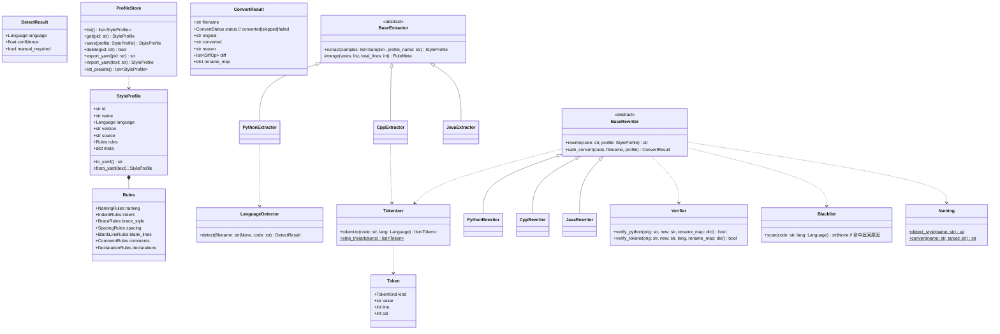
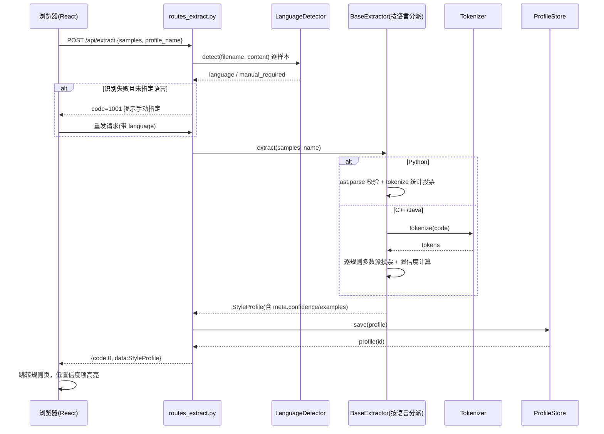
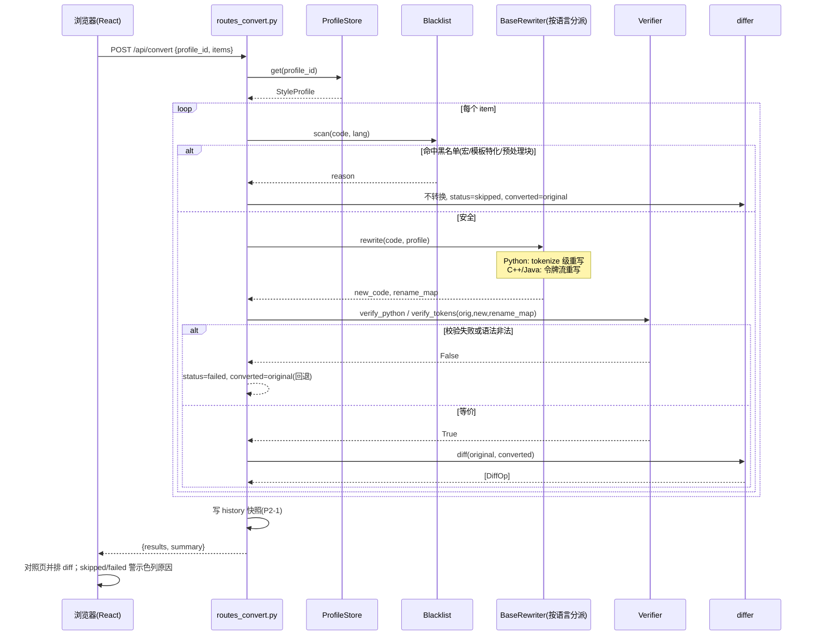
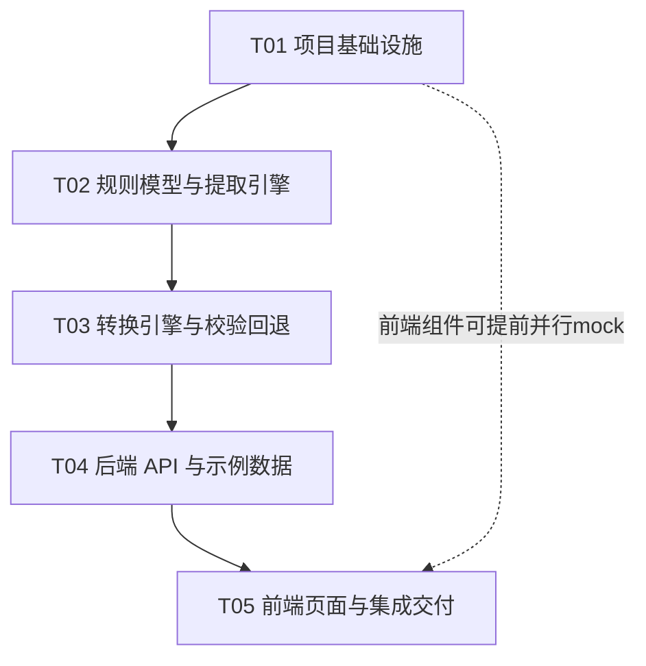

# Code Style Toolbox — 系统架构设计文档

> 架构师：高见远（Bob）｜ 基于 `docs/PRD.md` v1.0 与主理人裁决意见
> 工作目录：`D:/Creative Mind 2nd/Code Style Toolbox`

---

## 1. 实现方案与框架选型

### 1.1 核心技术挑战

| 挑战 | 应对策略 |
|---|---|
| C++/Java 无 JVM、无完整 AST 可用 | 自研**令牌化扫描器**（tokenizer）：风格转换只改空白/括号位置/命名等表层形式，令牌流 + 作用域启发足以支撑，不需要完整语法树 |
| 语义等价保证（裁决 1） | Python：内置 `ast` 模块做 AST 等价校验（应用标识符逆重命名映射后比对 `ast.dump`）；C++/Java：**令牌流等价 + 标识符重命名映射校验**（剔除空白/注释、归一化括号位置后 token 序列必须一致） |
| C++ 不安全构造（裁决 1） | 黑名单检测：函数式宏 `#define X(...)`、模板特化 `template<>`、预处理条件块 `#if/#ifdef/#ifndef` → 命中即跳过文件并提示原因 |
| 粘贴短代码语言识别（裁决 2） | 扩展名优先 + 关键字/语法特征打分器；置信度低于阈值时返回 `unknown`，前端允许**手动指定语言** |
| Python 重写不能丢注释/格式 | 不用 `ast.unparse`（会丢注释与排版），改用 `tokenize` 模块做**令牌级重写**（缩进、空白、空行、命名），`ast` 仅用于校验与作用域分析 |
| 绿色免安装交付（裁决 4） | PyInstaller `--onedir` 打包后端为 exe，前端 Vite 构建产物作为静态文件内嵌，由后端托管；同时提供 `run.bat` / `run.ps1` 源码直跑脚本 |

### 1.2 框架选型

| 层 | 选型 | 理由 |
|---|---|---|
| 后端框架 | **FastAPI + uvicorn** | 类型驱动（Pydantic 天然契合规则 Profile schema）、自动 OpenAPI 文档便于联调、PyInstaller 打包成熟；Flask 无 schema 校验优势，弃用 |
| 规则序列化 | **YAML（PyYAML）** | 规则文件需人读人改（P0-2），YAML 可读性优于 JSON；Pydantic 模型 ↔ YAML 双向转换 |
| Python 分析 | 标准库 `ast` + `tokenize` | 零依赖、语义权威 |
| C++/Java 分析 | 自研 tokenizer（正则 + 状态机） | 满足"不依赖 JVM"硬约束；风格层重写无需完整 parser |
| diff | 标准库 `difflib` | 生成结构化行级 diff（opcodes），前端渲染并排视图 |
| 前端 | **Vite + React 18 + TypeScript + MUI 5 + Tailwind 3** | 主理人裁决 5 指定栈；MUI 提供表单/树/步骤器组件，Tailwind 负责布局微调；语法高亮用 `prism-react-renderer`（纯 JS，无 WASM/原生依赖） |
| 打包 | **PyInstaller 6（--onedir）** | 绿色免安装主形态；onedir 启动快于 onefile 且便于用户查看内置示例/预设规则 |
| 界面宿主 | 系统默认浏览器（`webbrowser.open`） | 裁决 5：不用 Electron；后端启动后自动开浏览器 |

### 1.3 架构模式

经典**分层前后端分离（本地版）**：

```
浏览器（React SPA，静态文件由 FastAPI 托管）
   │  HTTP/JSON (127.0.0.1:动态端口)
   ▼
FastAPI 路由层（api/） ── Pydantic schema 校验
   ▼
服务/引擎层（core/）：detector → extractor / rewriter → verifier → diff
   ▼
持久层：profile_store（YAML 文件）+ history（JSONL）
```

引擎层**不依赖** FastAPI，可被 CLI（P2-3）直接复用；所有处理全本地、零网络请求（P0-7）。

---

## 2. 文件列表

```
Code Style Toolbox/
├── docs/
│   ├── PRD.md                            # 已有
│   └── ARCHITECTURE.md                   # 本文档
├── backend/
│   ├── requirements.txt                  # pip 依赖
│   ├── toolbox.spec                      # PyInstaller 打包配置
│   └── app/
│       ├── __init__.py
│       ├── main.py                       # FastAPI 入口：挂载路由、静态托管、端口选择、自动开浏览器
│       ├── config.py                     # 路径常量、数据目录初始化、端口策略
│       ├── models/
│       │   ├── __init__.py
│       │   └── profile.py                # StyleProfile Pydantic 模型（规则 schema 单一事实源）
│       ├── api/
│       │   ├── __init__.py
│       │   ├── schemas.py                # 请求/响应 DTO（含统一响应包装）
│       │   ├── routes_extract.py         # 语言识别 + 风格提取
│       │   ├── routes_profiles.py        # 规则集 CRUD/导入导出/预设
│       │   └── routes_convert.py         # 转换（粘贴/单文件/批量）+ 历史
│       └── core/
│           ├── __init__.py
│           ├── detector.py               # 语言识别（扩展名 + 特征打分）
│           ├── tokenizer.py              # C++/Java 通用令牌化扫描器
│           ├── naming.py                 # 命名风格判定与转换（snake/camel/Pascal/UPPER）
│           ├── blacklist.py              # C++/Java 不安全构造检测
│           ├── verifier.py               # 等价校验：Python AST / 令牌流 + 重命名映射
│           ├── differ.py                 # difflib 结构化 diff
│           ├── profile_store.py          # 规则集落盘/加载/导入导出/预设
│           ├── extractor/
│           │   ├── __init__.py
│           │   ├── base.py               # BaseExtractor 抽象 + 置信度聚合
│           │   ├── python_extractor.py   # 基于 ast+tokenize 的规则归纳
│           │   ├── cpp_extractor.py      # 基于 tokenizer 的规则归纳
│           │   └── java_extractor.py     # 基于 tokenizer 的规则归纳
│           └── rewriter/
│               ├── __init__.py
│               ├── base.py               # BaseRewriter：rewrite → verify → 回退 编排
│               ├── python_rewriter.py    # tokenize 级重写（缩进/空白/空行/命名/docstring）
│               ├── cpp_rewriter.py       # 括号风格/缩进/空白/命名重写
│               └── java_rewriter.py      # 同上（Java 规则差异）
├── frontend/
│   ├── package.json
│   ├── vite.config.ts                    # 构建 outDir → backend/app/static，dev 代理 /api
│   ├── tsconfig.json
│   ├── tailwind.config.js
│   ├── postcss.config.js
│   ├── index.html
│   └── src/
│       ├── main.tsx                      # 入口
│       ├── App.tsx                       # 路由 + 全局步骤导航 + 全局状态（当前规则集/语言）
│       ├── theme.ts                      # MUI 主题
│       ├── index.css                     # Tailwind 指令 + 全局样式
│       ├── types.ts                      # 与后端 schema 对齐的 TS 类型
│       ├── api/client.ts                 # fetch 封装（统一响应解包、错误码处理）
│       ├── pages/
│       │   ├── HomePage.tsx              # 功能卡片 + 一键演示（P1-3）
│       │   ├── ExtractPage.tsx           # 上传/拖拽样例、语言徽标、触发提取
│       │   ├── RulesPage.tsx             # 规则分类树 + 表单编辑 + 低置信度高亮 + 导入导出切换
│       │   ├── ConvertPage.tsx           # 粘贴/单文件/批量 Tab、校验状态、进度与结果清单
│       │   └── DiffPage.tsx              # 并排 diff、警示项、采纳导出
│       └── components/
│           ├── StepNav.tsx               # 顶部步骤式导航（提取→规则→转换→对照）
│           ├── FileDropZone.tsx          # 拖拽/多文件上传
│           ├── CodeEditor.tsx            # 代码粘贴域（prism 高亮、语言徽标、手动指定语言）
│           ├── RuleForm.tsx              # 单条/单组规则编辑控件（select/switch/number）
│           ├── ConfidenceBadge.tsx       # 置信度徽标（低置信度醒目色）
│           ├── DiffView.tsx              # 并排 diff 渲染（行内增删标记 + 语法高亮）
│           └── ResultList.tsx            # 批量结果清单（成功/跳过/失败 + 原因）
├── examples/                             # 内置示例（P1-3，打包进 exe 目录）
│   ├── README.md                         # 演示引导说明
│   ├── sample_python/                    # messy_demo.py（"别人风格"的待转换样例）
│   ├── sample_cpp/                       # messy_demo.cpp
│   └── sample_java/                      # MessyDemo.java
├── data/                                 # 运行时数据（源码运行时位于根目录；打包后置于 exe 同级，首次运行自动创建）
│   ├── profiles/                         # 用户规则集 *.yaml
│   ├── presets/                          # 内置预设：pep8.yaml / google_cpp.yaml / google_java.yaml（P2-2，随包发布）
│   └── history/                          # 转换历史 *.jsonl + 快照（P2-1）
└── scripts/
    ├── run.bat                           # 一键启动（源码模式：建 venv、装依赖、起后端）
    ├── run.ps1                           # 同上 PowerShell 版
    ├── dev.bat                           # 开发模式（uvicorn --reload + vite dev 双进程）
    ├── build_frontend.bat                # 前端构建 → backend/app/static
    └── package.bat                       # 全量打包：前端构建 + PyInstaller → dist/CodeStyleToolbox/
```

---

## 3. 数据结构与接口

### 3.1 风格规则 Profile 最终 Schema

在 PRD YAML 草案基础上**裁剪与落地**（裁剪原则：只做令牌层可安全实现的规则）。规则值与元数据分离：`meta` 与规则树同构，承载置信度与证据。

```yaml
# data/profiles/<id>.yaml
style_profile:
  id: "a1b2c3d4"                 # 8 位短 id（文件名）
  name: "my_team_style"
  language: "python"             # python | cpp | java
  version: "1.0"
  created_at: "2025-01-01T12:00:00Z"
  source: "extracted"            # extracted | preset | manual

  rules:
    naming:
      variables: "snake_case"    # snake_case | camelCase | PascalCase | UPPER_SNAKE
      functions: "snake_case"
      classes: "PascalCase"
      constants: "UPPER_SNAKE"
      private_prefix: "_"        # python/java 私有前缀；"" 表示无
      member_prefix: ""          # C++ 成员前缀如 "m_"
    indent:
      style: "space"             # space | tab
      size: 4                    # 2 | 4 | 8
    brace_style:                 # 仅 cpp/java 生效
      style: "k_and_r"           # k_and_r | allman
      space_before_paren: true   # "if (" vs "if("
    spacing:
      space_around_operators: true
      space_after_comma: true
      trim_trailing_whitespace: true
    blank_lines:
      max_consecutive: 2
      between_functions: 2       # python 顶层 2 / cpp·java 1
      after_imports: 1
    comments:
      inline_min_spaces: 2       # 行尾注释前最少空格
      docstring_format: "google" # python: google | numpy | none（提取识别，转换不强制改写正文）
    declarations:                # 仅"可安全提取展示、默认不参与自动重写"，见 §9 假设
      cpp_const_style: "east"    # east | west（转换仅做 const 位置移动，令牌级安全）
      python_type_hints: true

  meta:                          # 与 rules 同构的子树，支撑 P1-4
    naming:
      variables:    { confidence: 0.92, samples: 148, examples: ["user_name", "total_count"] }
      functions:    { confidence: 0.88, samples: 96,  examples: ["load_data"] }
    indent:
      size:         { confidence: 1.0,  samples: 412, examples: [] }
```

**字段约定**：

- `confidence ∈ [0,1]`；`< 0.6` 或 `samples < 30` 或样例总行数 `< 200`（裁决 3，软提示）→ 前端醒目低置信度标识。
- `examples` 最多保留 3 条短片段，供规则页悬浮预览。
- 冲突规则（样本中两种风格均 ≥30%）→ confidence 取多数派比例并打 `conflict: true`。
- 裁剪掉的 PRD 草案字段（`continuation_size`、`exception_style`、`prefer_early_return`、`idioms.*`、`max_line_length` 自动折行、`header_block`、`docstring` 正文改写、`cpp_use_auto`/`java_use_var`）：令牌层无法 100% 保证语义安全，本期仅提取展示其中可判定项，**不参与自动重写**（详见 §9）。

### 3.2 核心类图（引擎层）



### 3.3 REST API 列表

统一响应包装：`{ "code": 0, "message": "ok", "data": ... }`；`code != 0` 即失败（错误码见 §8）。所有路径前缀 `/api`。

| 方法 | 路径 | 请求体 | 响应 data | 说明 |
|---|---|---|---|---|
| GET | `/api/health` | — | `{status:"ok", version}` | 前端启动探测 |
| POST | `/api/detect` | `{code:str, filename?:str}` | `DetectResult{language, confidence, manual_required}` | 语言识别；`manual_required=true` 时前端弹手动选择 |
| POST | `/api/extract` | `{samples:[{filename,content}], language?:str, profile_name:str}` | `StyleProfile` | 风格提取并自动落盘；返回含 meta 置信度 |
| GET | `/api/profiles` | — | `[{id,name,language,source,updated_at}]` | 规则集列表（摘要） |
| GET | `/api/profiles/{pid}` | — | `StyleProfile` | 完整规则（含 meta） |
| PUT | `/api/profiles/{pid}` | `StyleProfile` | `StyleProfile` | 保存编辑（服务端校验 schema） |
| DELETE | `/api/profiles/{pid}` | — | `{deleted:true}` | |
| POST | `/api/profiles/import` | `{yaml_text:str}` | `StyleProfile` | 导入（重新分配 id） |
| GET | `/api/profiles/{pid}/export` | — | YAML 纯文本（`text/yaml`） | 导出下载 |
| GET | `/api/presets` | — | `[StyleProfile]` | 内置预设（P2-2） |
| POST | `/api/convert` | `{profile_id:str, items:[{filename?,content}], language?:str}` | `{results:[ConvertResult], summary:{total,converted,skipped,failed}}` | 粘贴/单文件/批量共用；逐项安全回退 |
| GET | `/api/history` | — | `[{id,time,profile_name,files:[...]}]` | 转换历史（P2-1） |
| POST | `/api/history/{hid}/restore` | — | `{restored:[filename]}` | 还原快照（P2-1） |
| GET | `/api/examples` | — | `[{language, files:[{filename,content}]}]` | 内置示例读取（P1-3 一键演示） |

**关键 DTO**（`api/schemas.py`，与前端 `types.ts` 一一对应）：

```python
class ConvertResult(BaseModel):
    filename: str
    status: Literal["converted", "skipped", "failed"]
    original: str
    converted: str            # skipped/failed 时 == original（安全回退 P0-6）
    reason: str = ""          # skipped/failed 原因（黑名单命中/语法错误/校验失败）
    diff: list[DiffOp]        # DiffOp{tag: equal|delete|insert|replace, old_lines:[str], new_lines:[str]}
    rename_map: dict[str, str] = {}
```

---

## 4. 程序调用流程

### 4.1 风格提取流程



### 4.2 风格转换流程（单条目，批量即循环）



---

## 5. 待明确事项（含本期假设）

| # | 事项 | 本期假设/处理方式 |
|---|---|---|
| 1 | PRD 草案中 `idioms.*`、`prefer_early_return`、`exception_style` 等涉及代码结构变换 | **只提取展示，不参与自动重写**。结构变换（如循环转推导式）超出"表层形式"安全边界，P0-3 验收以令牌/AST 等价为准，此类变换无法保证等价 |
| 2 | `max_line_length` 自动折行、`header_block` 自动插入 | 同上，本期不做自动折行/插入；仅做 `trim_trailing_whitespace` 等无损项 |
| 3 | C++ `const east/west` 转换 | 令牌级左右交换可实现且可校验，纳入重写范围；若验证失败自动回退 |
| 4 | Python 命名重写的作用域精度 | 以 `ast` 收集定义点（函数/类/赋值目标/参数）+ `tokenize` 全词替换同名 NAME 令牌；导入名、属性访问（`obj.attr`）、关键字参数名**不改写**（避免改 API 调用语义，P0-3） |
| 5 | 批量目录选择 | 浏览器 `<input webkitdirectory>` 读取目录文件（纯本地，不上传服务器落盘），结果由用户"采纳导出"为 zip/覆盖复制——**导出方式**细节交由工程师按 `Blob` 下载 zip（jszip）实现 |
| 6 | 历史快照容量 | history 保留最近 50 条，超出滚动删除 |
| 7 | 端口冲突 | 默认 18765，占用时递增探测；打包 exe 与源码模式同一策略 |

---

## 6. 依赖包列表

### 6.1 pip（`backend/requirements.txt`）

```
fastapi>=0.115        # Web 框架
uvicorn[standard]>=0.30  # ASGI 服务器
pydantic>=2.8         # 数据模型/schema 校验
pyyaml>=6.0           # 规则集 YAML 读写
python-multipart>=0.0.9  # （备用）表单/文件上传
pyinstaller>=6.10     # 打包（仅构建期需要）
```

> 引擎核心（ast/tokenize/difflib/re/webbrowser）全部标准库，零额外依赖。

### 6.2 npm（`frontend/package.json`）

```
# dependencies
react@^18.3.1
react-dom@^18.3.1
react-router-dom@^6.26.0        # 页面路由
@mui/material@^5.16.0           # 组件库
@emotion/react@^11.13.0         # MUI 依赖
@emotion/styled@^11.13.0        # MUI 依赖
@mui/icons-material@^5.16.0     # 图标
prism-react-renderer@^2.3.1     # 代码语法高亮（纯 JS）
jszip@^3.10.1                   # 批量导出 zip
# devDependencies
vite@^5.4.0
@vitejs/plugin-react@^4.3.1
typescript@^5.5.0
tailwindcss@^3.4.0
postcss@^8.4.0
autoprefixer@^10.4.0
@types/react@^18.3.0
@types/react-dom@^18.3.0
```

---

## 7. 任务列表（按实现顺序，共 5 个）

| Task ID | 任务名 | 涉及文件 | 依赖 | 优先级 |
|---|---|---|---|---|
| **T01** | **项目基础设施**：后端骨架 + 前端脚手架 + 启动脚本（全配置集中，可跑通"后端托管前端空页 + /api/health"） | `backend/requirements.txt`, `backend/app/__init__.py`, `backend/app/main.py`, `backend/app/config.py`, `frontend/package.json`, `frontend/vite.config.ts`, `frontend/tsconfig.json`, `frontend/tailwind.config.js`, `frontend/postcss.config.js`, `frontend/index.html`, `frontend/src/main.tsx`, `frontend/src/App.tsx`, `frontend/src/theme.ts`, `frontend/src/index.css`, `scripts/run.bat`, `scripts/run.ps1`, `scripts/dev.bat`, `scripts/build_frontend.bat` | — | P0 |
| **T02** | **规则模型与提取引擎**：Profile schema + 语言识别 + 三语言提取器 + 命名工具 | `backend/app/models/profile.py`, `backend/app/api/schemas.py`, `backend/app/core/detector.py`, `backend/app/core/tokenizer.py`, `backend/app/core/naming.py`, `backend/app/core/extractor/base.py`, `backend/app/core/extractor/python_extractor.py`, `backend/app/core/extractor/cpp_extractor.py`, `backend/app/core/extractor/java_extractor.py`, `frontend/src/types.ts` | T01 | P0 |
| **T03** | **转换引擎与校验回退**：三语言重写器 + 等价校验 + 黑名单 + diff + 预设规则 | `backend/app/core/rewriter/base.py`, `backend/app/core/rewriter/python_rewriter.py`, `backend/app/core/rewriter/cpp_rewriter.py`, `backend/app/core/rewriter/java_rewriter.py`, `backend/app/core/verifier.py`, `backend/app/core/blacklist.py`, `backend/app/core/differ.py`, `backend/app/core/profile_store.py`, `data/presets/pep8.yaml`, `data/presets/google_cpp.yaml`, `data/presets/google_java.yaml` | T02 | P0 |
| **T04** | **后端 API 与示例数据**：全部 REST 路由 + 历史 + 内置示例 | `backend/app/api/routes_extract.py`, `backend/app/api/routes_profiles.py`, `backend/app/api/routes_convert.py`, `examples/README.md`, `examples/sample_python/messy_demo.py`, `examples/sample_cpp/messy_demo.cpp`, `examples/sample_java/MessyDemo.java` | T03 | P0 |
| **T05** | **前端页面与集成交付**：五个页面 + 组件库 + API 联调 + 打包脚本 | `frontend/src/api/client.ts`, `frontend/src/pages/HomePage.tsx`, `frontend/src/pages/ExtractPage.tsx`, `frontend/src/pages/RulesPage.tsx`, `frontend/src/pages/ConvertPage.tsx`, `frontend/src/pages/DiffPage.tsx`, `frontend/src/components/StepNav.tsx`, `frontend/src/components/FileDropZone.tsx`, `frontend/src/components/CodeEditor.tsx`, `frontend/src/components/RuleForm.tsx`, `frontend/src/components/ConfidenceBadge.tsx`, `frontend/src/components/DiffView.tsx`, `frontend/src/components/ResultList.tsx`, `backend/toolbox.spec`, `scripts/package.bat` | T04 | P0 |

> 说明：T05 依赖 T04 仅为联调方便（需要真实 API）；前端组件开发本身可在 T01 后与后端并行（按 §3.3 契约 mock）。优先级全部为 P0，因需求池 P0 项横跨全部任务；P1/P2 项（批量报告、预设、历史）已分别并入 T03/T04/T05。

---

## 8. 共享知识（跨文件约定）

```
【统一响应格式】所有 /api 响应：{"code": int, "message": str, "data": any}
  成功 code=0；前端 api/client.ts 统一解包，code!=0 抛 ApiError(message)。

【错误码】
  0     成功
  1001  语言识别失败（需手动指定）
  1002  输入语法非法（Python ast.parse 失败 / 令牌流括号不配平）
  2001  命中不安全构造黑名单（宏/模板特化/预处理条件块）→ 该文件 skipped
  2002  等价校验失败（AST/令牌流不等价）→ 自动回退 original，status=failed
  3001  规则集不存在 / schema 校验失败
  5000  未预期服务端错误

【规则文件】data/profiles/<id>.yaml，UTF-8，结构见 §3.1；
  id 为 8 位十六进制短码；文件名即 <id>.yaml；meta 与 rules 同构子树。
  预设存 data/presets/*.yaml，source="preset"，只读（编辑即另存新 id）。

【命名风格枚举】snake_case | camelCase | PascalCase | UPPER_SNAKE
  （命名工具 naming.py 为唯一判定/转换实现，前后端共用语义）

【语言枚举】python | cpp | java；文件扩展名映射：
  .py→python；.cpp/.cc/.cxx/.h/.hpp→cpp；.java→java

【目录约定】
  源码模式：数据目录 = <项目根>/data；打包模式：数据目录 = exe 同级/data
  （config.py 统一用 sys.frozen 判断，任何模块不得自行拼路径）
  前端构建产物 → backend/app/static，FastAPI 挂载为 "/"（SPA fallback 到 index.html）

【Diff 结构】DiffOp = {tag: "equal"|"delete"|"insert"|"replace",
  old_lines: string[], new_lines: string[]}，由 difflib opcodes 转换，
  前端 DiffView 按 tag 渲染红/绿/灰，不再二次计算。

【安全铁律】任何重写路径必须经过 BaseRewriter.safe_convert：
  黑名单扫描 → 语法校验 → rewrite → 等价 verify → 失败则 converted=original。
  禁止任何 API 直接返回未经 verify 的重写结果。

【离线约束】前后端均不得发起任何非 127.0.0.1 的网络请求（P0-7）；
  MUI 字体等一律打包本地化，不用 CDN。
```

---

## 9. 任务依赖图


